

# PowerSetSetup ⚡

**[English](#english)** &nbsp;&nbsp; 🌐 &nbsp;&nbsp; **[Русский](#русский)**

---

# English

> **Switch Windows power plans in one click, and clean up the ones you don't need. No Control Panel digging, no `powercfg` commands to memorize.**

## 🤔 What is it and who is it for?

Windows has power plans that decide how your PC trades speed for energy use. Switching between them is awkward: the plan you need is often hidden in the Control Panel, missing entirely, or only reachable through `powercfg` commands with long GUIDs.

**PowerSetSetup** puts the three modes people actually use on one screen:

| Mode | When to use it |
|---|---|
| ⚡ **Maximum performance** | Games, rendering, compiling: when speed matters |
| ⚖️ **Balanced** | Everyday work |
| 🔋 **Power saving** | A laptop away from the socket: when battery life matters |

Pick a mode and you're done. It manages the same standard Windows power plans through the built-in `powercfg` tool. It does not change hidden system settings.

**It is for you if** you switch between gaming and battery modes, your plan list is cluttered by laptop vendors, or you simply don't want to use the command line.

## 🖼️ Screenshots

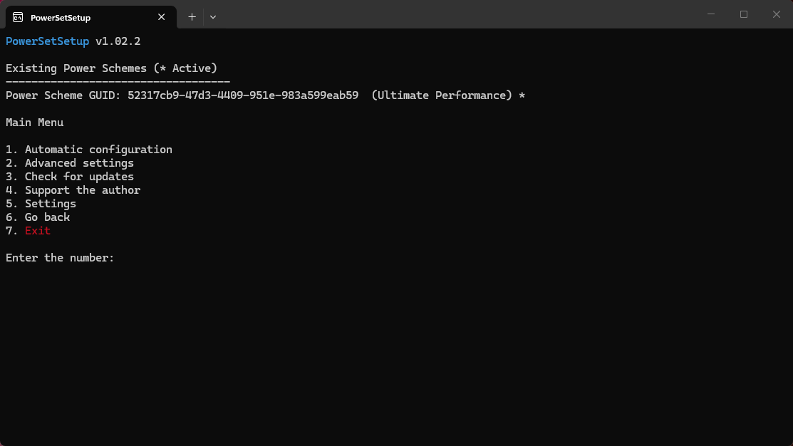

  

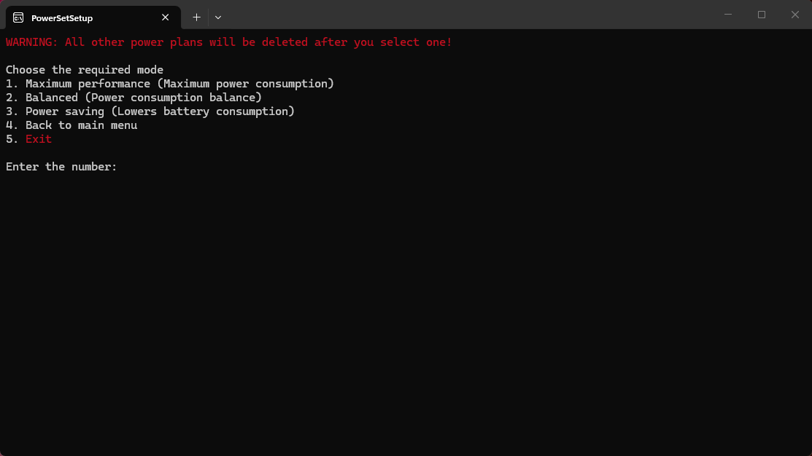

  

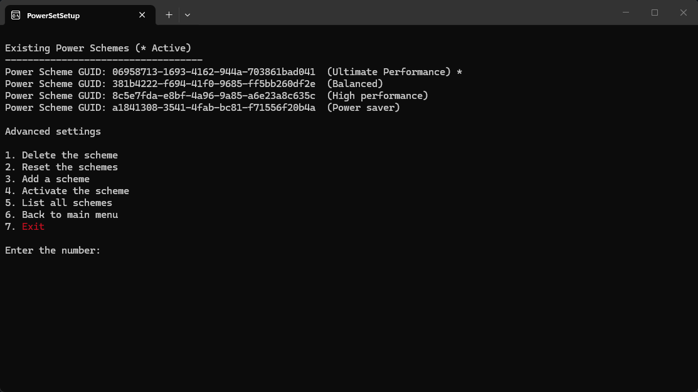

Other screens: "Settings" and "Advanced Scheme Settings"

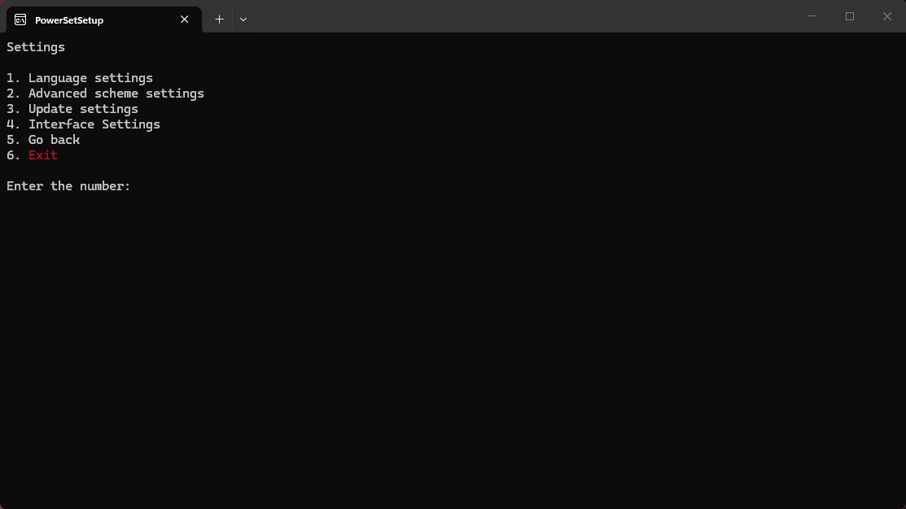
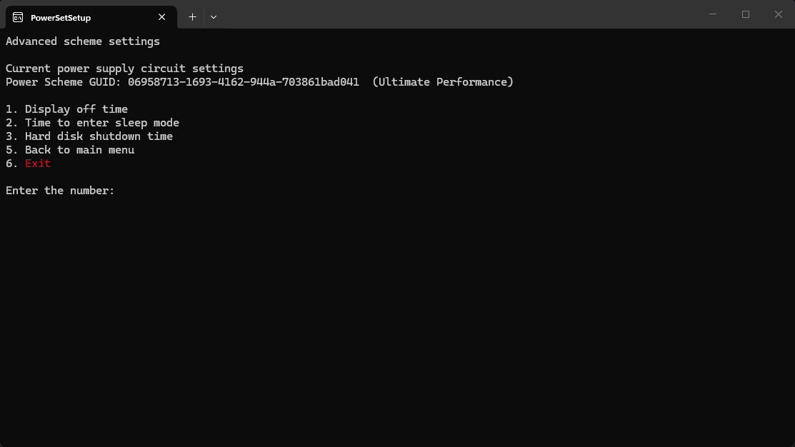

## 💡 Why PowerSetSetup

- **One screen, one click.** The main modes are always in front of you.
- **Focused on one job.** It only manages power plans. It is not a "PC optimizer" that edits hundreds of unrelated settings, and it does not run background services.
- **Safe cleanup.** Find extra and hidden plans. The active plan can't be deleted by mistake.
- **Works in English and Russian.** Plans are identified by GUID, not by their translated names.
- **Free for personal use** under the PolyForm Noncommercial License.

## ✨ Features

- 🔍 View all power plans and see which one is active
- 🔄 **Activate** a plan: Maximum performance, Balanced or Power saving
- 🗑️ **Delete** unneeded plans one by one or find them by GUID
- ♻️ **Reset** to Windows default plans
- 🆔 Get the **ID (GUID)** of any plan
- 🎨 Two interface languages
- 🔔 Update check right inside the app (portable version too)

## 🚀 Installation

1. **▶** Download `PowerSetSetup_installer.exe` from [Releases](https://github.com/BrocatScript/PowerSetSetup/releases/latest)
2. **📁** Choose the install path
3. **⏳** Wait for the installation to finish
4. **✅** Launch the app and pick your power plan

**Requirements:** Windows 10 or 11.

## ⚠️ Important Notes

| | Note |
|---|---|
| 🔁 | Resetting to defaults can remove your custom plans |
| 🪟 | Requires **Windows 10/11**, older versions are not supported |
| 🛡️ | Download only from the official [Releases](https://github.com/BrocatScript/PowerSetSetup/releases) page. If SmartScreen or your antivirus warns about a new unsigned program, check that the file came from this page before allowing it |

## 🛠️ Troubleshooting

1. Close resource-intensive programs and try again
2. Make sure you are on Windows 10 or 11
3. If the installer is blocked, see the note above about SmartScreen / antivirus
4. Still stuck? [Open an issue](https://github.com/BrocatScript/PowerSetSetup/issues) or write to **[brocatscript.support@gmail.com](mailto:brocatscript.support@gmail.com)**

## 📊 Statistics

<picture>
  <source media="(prefers-color-scheme: dark)" srcset="stats/stats_dashboard_en_dark.png">
  <source media="(prefers-color-scheme: light)" srcset="stats/stats_dashboard_en_light.png">
  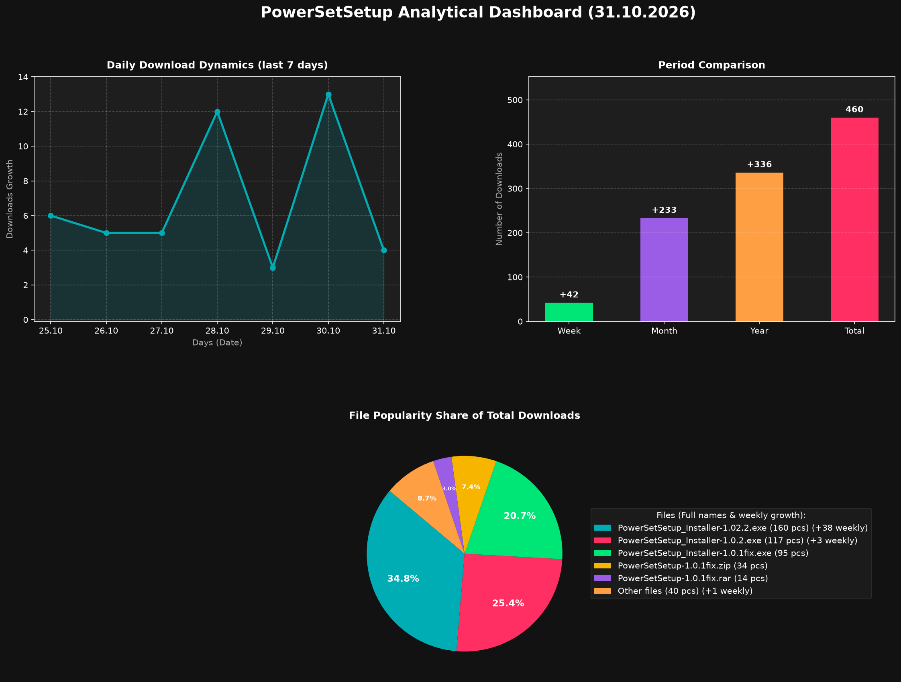
</picture>

*Updates within an hour or more...*

## 📜 License

[PolyForm Noncommercial License](https://github.com/BrocatScript/PowerSetSetup/blob/main/docs/LICENSE.md). Free for noncommercial use.

> Copyright © 2025-2026 BrocatScript.

## 💝 Support the Author

If the tool is useful to you, you can support its development:

Questions, ideas or collaboration: **[brocatscript.support@gmail.com](mailto:brocatscript.support@gmail.com)**

**Made with ❤️ by BrocatScript**

---

# Русский

> **Переключайте схемы электропитания Windows в один клик и удаляйте ненужные. Без поисков по панели управления и без команд `powercfg`.**

## 🤔 Что это и для кого

В Windows есть схемы электропитания: они определяют, что важнее для компьютера: скорость или экономия энергии. Переключаться между ними неудобно: нужная схема часто спрятана в панели управления, вообще отсутствует или доступна только через `powercfg` с длинными GUID.

**PowerSetSetup** выводит на один экран три режима, которыми реально пользуются:

| Режим | Когда нужен |
|---|---|
| ⚡ **Максимальная производительность** | Игры, рендер, сборка проектов: когда важна скорость |
| ⚖️ **Сбалансированная** | Повседневная работа |
| 🔋 **Экономия энергии** | Ноутбук вдали от розетки: когда важна автономность |

Выбрали режим и готово. Программа управляет теми же стандартными схемами Windows через встроенную утилиту `powercfg` и не меняет скрытые системные параметры.

**Она подойдёт вам, если** вы переключаетесь между игровым и экономным режимами, список схем засорён производителями ноутбуков или вы просто не хотите работать с командной строкой.

## 🖼️ Скриншоты

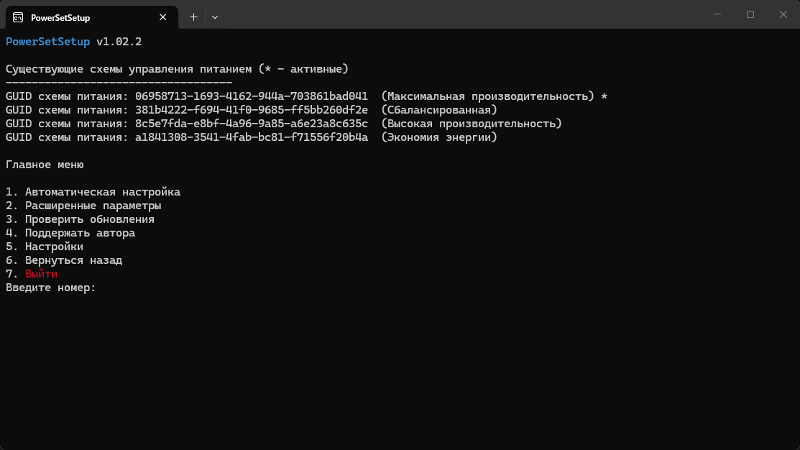

  

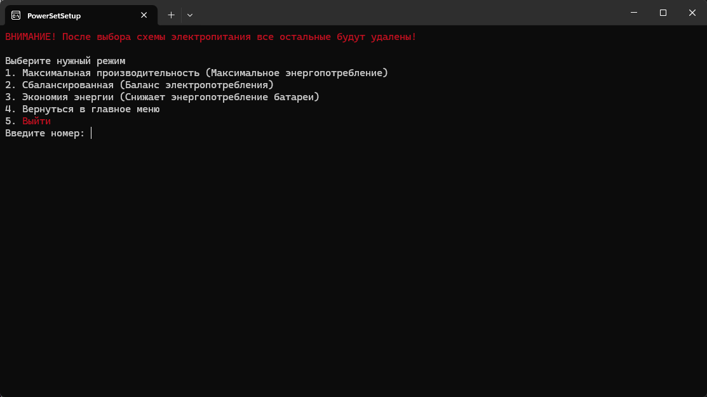

  

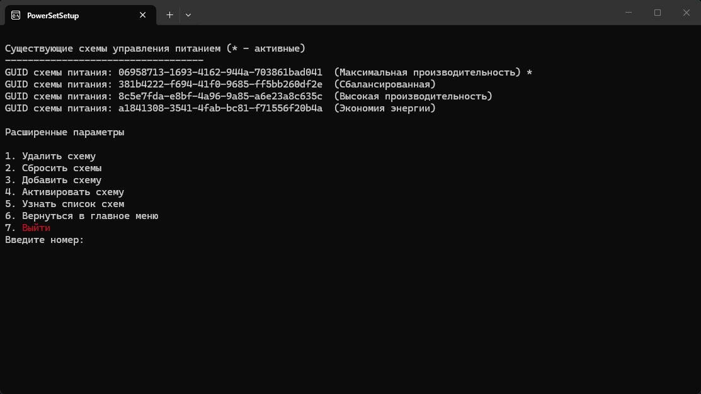

Другие экраны: «Настройки» и «Дополнительные настройки схемы»

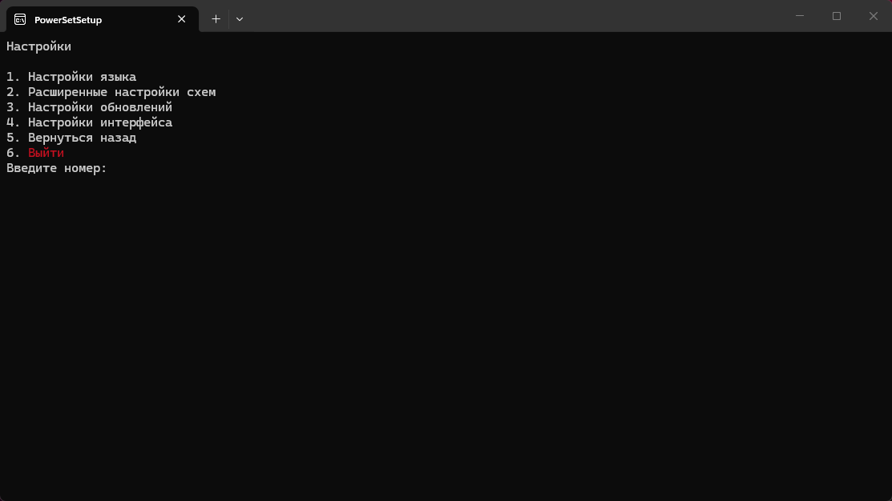
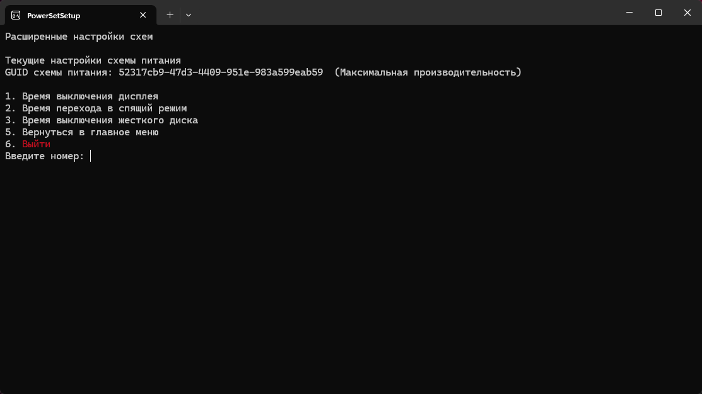

## 💡 Почему PowerSetSetup

- **Один экран, один клик.** Основные режимы всегда перед глазами.
- **Одна задача.** Только схемы электропитания. Это не «оптимизатор ПК», который правит сотни посторонних параметров, и у программы нет фоновых служб.
- **Безопасная очистка.** Найдите лишние схемы и скрытые. Активную схему нельзя удалить по ошибке.
- **Работает на Русском и Английском.** Схемы определяются по GUID, а не по переведённому названию.
- **Бесплатно для личного использования** по лицензии PolyForm Noncommercial.

## ✨ Возможности

- 🔍 Просмотр всех схем и отметка активной
- 🔄 **Активация** схемы: Максимальная производительность, Сбалансированная или Экономия энергии
- 🗑️ **Удаление** ненужных схем по одной или поиск по GUID
- ♻️ **Сброс** до стандартных схем Windows
- 🆔 Получение **ID (GUID)** любой схемы
- 🎨 Два языка интерфейса
- 🔔 Проверка обновлений прям в приложении(для портативных тоже)

## 🚀 Установка

1. **▶** Скачайте `PowerSetSetup_installer.exe` из [Релизов](https://github.com/BrocatScript/PowerSetSetup/releases/latest)
2. **📁** Выберите путь установки
3. **⏳** Дождитесь завершения установки
4. **✅** Запустите программу и выберите схему питания

**Требования:** Windows 10 или 11.

## ⚠️ Важные примечания

| | Примечание |
|---|---|
| 🔁 | Сброс до стандартных настроек может удалить ваши пользовательские схемы |
| 🪟 | Нужна **Windows 10/11**, более ранние версии не поддерживаются |
| 🛡️ | Скачивайте только со страницы [Релизов](https://github.com/BrocatScript/PowerSetSetup/releases). Если SmartScreen или антивирус предупреждает о новой программе без подписи, убедитесь, что файл скачан именно оттуда, и только потом разрешайте запуск |

## 🛠️ Если что-то не работает

1. Закройте ресурсоёмкие программы и повторите попытку
2. Убедитесь, что у вас Windows 10 или 11
3. Если установщик блокируется, см. примечание выше про SmartScreen и антивирус
4. Не помогло? [Создайте Issue](https://github.com/BrocatScript/PowerSetSetup/issues) или напишите на **[brocatscript.support@gmail.com](mailto:brocatscript.support@gmail.com)**

## 📊 Статистика

<picture>
  <source media="(prefers-color-scheme: dark)" srcset="stats/stats_dashboard_ru_dark.png">
  <source media="(prefers-color-scheme: light)" srcset="stats/stats_dashboard_ru_light.png">
  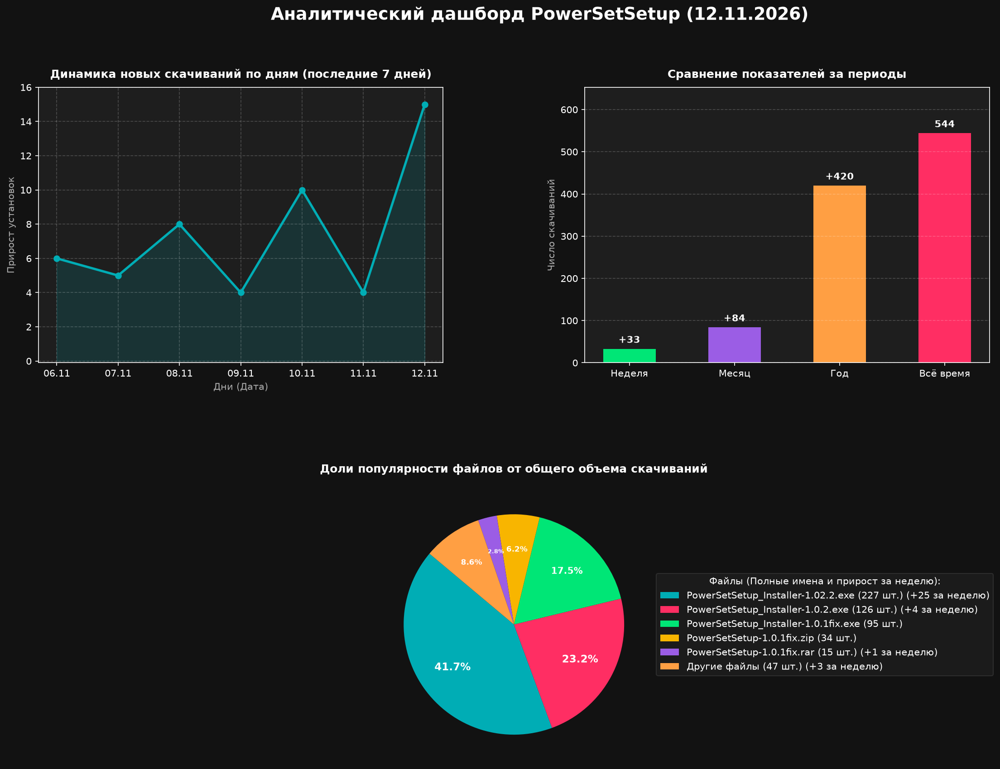
</picture>

*Обновляется в течение часа или более...*

## 📜 Лицензия

[PolyForm Noncommercial License](https://github.com/BrocatScript/PowerSetSetup/blob/main/docs/LICENSE.md). Бесплатно для некоммерческого использования.

> Copyright © 2025-2026 BrocatScript.

## 💝 Поддержите автора

Если программа вам полезна, можно поддержать её разработку:

Вопросы, идеи, сотрудничество: **[brocatscript.support@gmail.com](mailto:brocatscript.support@gmail.com)**

**Сделано с ❤️ BrocatScript**

